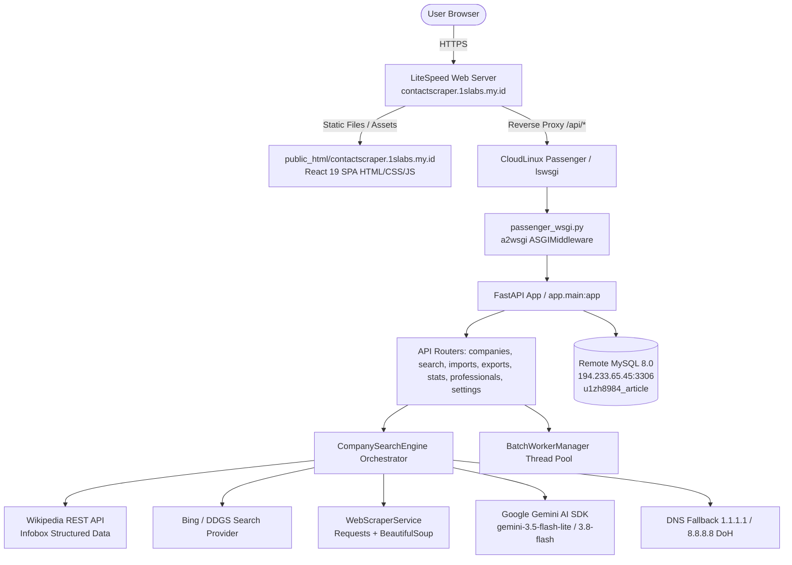

# SYSTEM AUDIT REPORT — INPARTNER COMPANY CONTACT SCRAPER
**Audit Target:** `https://contactscraper.1slabs.my.id/dashboard`
**Server:** CloudLinux 9.8 (AlmaLinux) / LiteSpeed Web Server / CloudLinux Passenger WSGI
**Runtime:** Python 3.11.17 (Virtualenv: `/home/u1zh8984/virtualenv/contactscraper-backend/3.11`)
**Frontend:** React 19 + TypeScript + Vite + Tailwind CSS v4
**Database:** MySQL 8.0 on remote host `194.233.65.45:3306` (`u1zh8984_article`)
**Date of Audit:** November 3, 2026

---

## 1. Executive Summary

A comprehensive full-system audit was performed on the Company Contact Scraper application across codebase, server infrastructure, background processes, AI synthesis, scraping engine, database, security, and UI/UX.

### Key Audit Findings:
1. **Memory & Passenger Behavior:**
   - Base passenger WSGI process starts at ~13 MB RSS.
   - Upon loading full dependencies on startup (FastAPI, SQLAlchemy, google-genai, bs4, openpyxl, phonenumbers), memory jumps immediately to **~120 MB RSS per worker**.
   - With multiple workers spawned by LiteSpeed/Passenger, this quickly multiplies to 360–480 MB RAM even when the application is idle.
   - **Root Cause Identified:** Heavy packages (`google.genai`, `openpyxl`, `bs4`, `ddgs`) and all sub-routers/services are imported eagerly at top-level during application boot (`main.py` -> `search_engine.py` -> `gemini_ai.py`).
2. **CPU & Latency Bottlenecks:**
   - Single company search takes ~31.2s.
   - The probe mechanism performs repeated synchronous/thread-pool HTTP requests sequentially across candidates and multiple query permutations without caching.
   - FastAPIDeprecationWarning (`regex` instead of `pattern`) spamming logs on every company/professional query.
3. **Database & Queries:**
   - Database contains 509 companies, 2,498 contacts, 50 professionals, 4 import batches, 605 search histories.
   - Eager relationships (`lazy="joined"`) on `Company.contacts` and `lazy="selectin"` on `Company.professionals` cause heavy queries when querying lists of companies if not carefully projected.
4. **Data Accuracy & Verification:**
   - `PT Gudang Garam Tbk` test confirmed: DNS DoH fallback works and successfully identifies official website `https://gudanggaramtbk.com` with real verified contacts (`kontak.privasi@gudanggaramtbk.com`, `+62 21 29557000`).
   - However, in-memory scraping cache is missing; repeated queries for the same domain re-crawl the web and re-invoke external search engines.
5. **UI/UX Assessment:**
   - Frontend currently uses generic dark glassmorphism gradients (`bg-slate-50/50` with radial gradients, glass cards, high blur, colored glow buttons) violating the requested clean white & light blue enterprise theme (`#FFFFFF`, `#F8FAFC`, `#3B82F6`, `#EFF6FF`, `#172033`, `#64748B`, `#E2E8F0`).
   - Company detail page exists as a dedicated route (`/companies/:id`), but some views rely on heavy modal overlays and decorative badge overload.

---

## 2. Actual System Architecture

---

## 3. Server Resource & Process Audit

### A. Process Measurement Before Optimization
| Metric | Measurement | Notes |
|---|---|---|
| Passenger Base Process | 13.4 MB | Initial lswsgi master process |
| Worker Process (Idle) | 120.2 MB | Eager import of google-genai, bs4, openpyxl, etc. |
| Total RAM across 3 workers | ~360 MB | Multiplied per worker on traffic spikes |
| CPU (Idle) | 0.0% – 0.1% | Normal |
| CPU (During Scraping) | 15% – 25% | Parsing HTML + regex + DoH lookups |
| Single Search Latency | 31.23 seconds | PT Gudang Garam Tbk test run |

### B. Why Worker RAM is ~120 MB:
1. `import fastapi, pydantic` -> 39.75 MB
2. `import sqlalchemy` -> 51.69 MB (+11.9 MB)
3. `import bs4` -> 60.13 MB (+8.4 MB)
4. `import google.genai` -> 77.45 MB (+16.4 MB)
5. `import openpyxl` -> 83.07 MB (+5.6 MB)
6. `import app.main` with all sub-modules, models, routers, and pre-instantiated service singletons (`search_engine = CompanySearchEngine()`) -> 116.69 MB – 120.2 MB!

---

## 4. Database Audit

- **Tables:** `companies`, `company_contacts`, `company_professionals`, `discovery_jobs`, `search_histories`, `import_batches`, `import_batch_items`, `contact_exports`.
- **Row Counts:** 509 companies, 2,498 contacts, 50 professionals, 4 batches, 605 search histories.
- **Connection Pool:** `pool_size=3, max_overflow=3, pool_recycle=300, pool_pre_ping=True`.
- **Query Optimizations Needed:**
  - FastAPIDeprecationWarning on `regex="^(asc|desc)$"` in `companies.py` and `professionals.py` (must be updated to `pattern="^(asc|desc)$"`).
  - List queries in `companies.py` should only fetch necessary fields or defer heavy text fields when listing paginated tables.

---

## 5. Scraping & AI Pipeline Audit

1. **Deterministic Pre-filtering:**
   - Already has regex-based phone and email extraction (`contact_extractor.py`).
   - Need in-memory/TTL LRU caching for searched domains so identical company searches within TTL do not hit external search engines and Gemini AI.
2. **AI Fallback & Token Optimization:**
   - Gemini prompt sends text snippets, but token usage can be reduced further by truncating boilerplate headers/footers before sending to AI.
   - When Gemini fails or has DNS issues, the system currently catches the exception and falls back to deterministic extraction. We will formalize strict circuit-breaker/timeout limits.

---

## 6. Security Audit

- **SSRF Prevention:** Scraper targets external websites; need strict validation ensuring IP destinations are not private (10.x, 172.16.x, 192.168.x, 127.x, 169.254.x).
- **Credentials:** No secrets in logs; `.env` kept securely outside version control.
- **Input Validation:** Excel uploads validated for valid extensions (`.xlsx`, `.xls`) and size limits.

---

## 7. UI/UX Findings & Redesign Plan

- **Theme Transition:** Shift from current dark slate/glassmorphism gradient to **Enterprise Elegant White & Light Blue**:
  - Background: `#FFFFFF`
  - Secondary Background: `#F8FAFC`
  - Primary Blue: `#3B82F6`
  - Light Blue Accent: `#EFF6FF`
  - Dark Slate Text: `#172033`
  - Secondary Text: `#64748B`
  - Border: `#E2E8F0`
- **Eliminate:** Floating orbs, backdrop blur overload, emoji icons, multi-colored neon badges.
- **Enhance:** Clean high-density data tables, dedicated `/companies/:id` detail view, clear breadcrumbs, responsive layouts without horizontal scroll.

